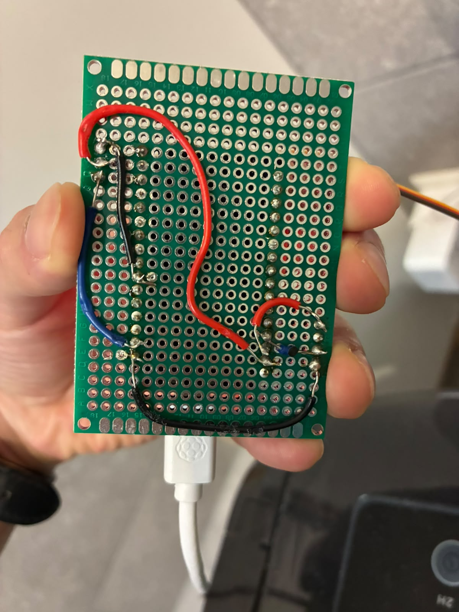
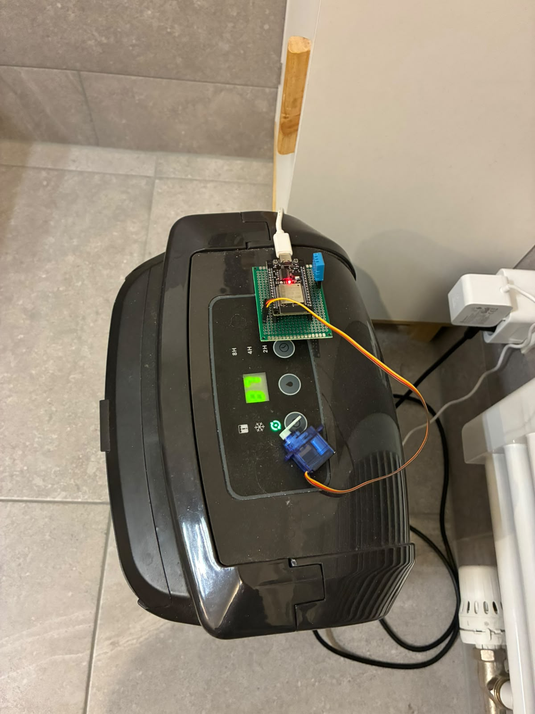
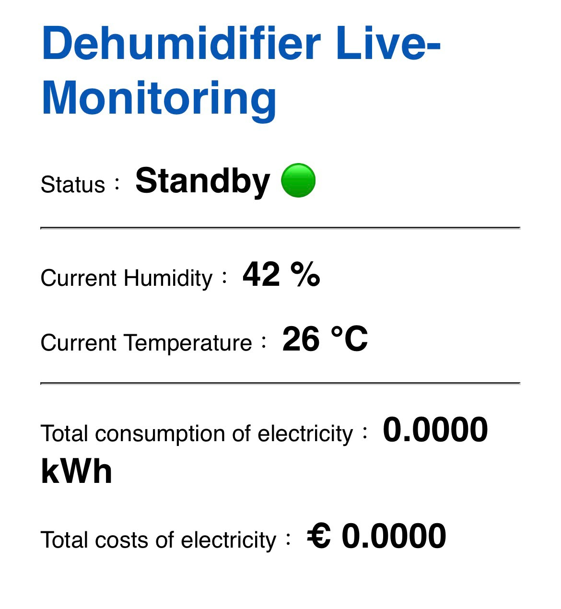

<h1 align="center">ESP32 Smart Dehumidifier Controller</h1>

Following the previous project with Raspberry Pi, this is an improved IoT project built with the ESP32 and the ESP-IDF framework. A lighter and compacter environmental controller comparing to bulky heavy Raspberry Pi. The system monitors ambient temperature and humidity in real-time using a DHT11 sensor. When the humidity is too high, it triggers a servo motor (simulating the physical button press of a dehumidifier). It also hosts a built-in Web Server to provide a live monitoring dashboard and calculates accumulated energy consumption and costs.

## Features

* **Automated Humidity Control**: When humidity reaches >= 60%, the servo rotates 65 degrees to turn on the dehumidifier. It automatically turns off when humidity drops to <= 49%.
* **Web Monitoring Dashboard**: Features an embedded HTTP server. Any device on the same local network can access the live temperature, humidity, and device status via a standard web browser.
* **Energy & Cost Estimation**: Automatically tracks the operating time of the dehumidifier and estimates the total cost based on a configured power rating (200W) and electricity rate (€0.24/kWh).
* **Time Synchronization (SNTP)**: Automatically syncs with NTP servers upon connection to output accurate, timestamped console logs.

## Screenshots & Wiring

**Wiring:**


**Full Setup (ESP32, DHT11, and Servo on Dehumidifier):**


**Web Monitoring Dashboard:**


## Hardware Requirements

* **Development Board**: ESP32 (NodeMCU or compatible)
* **Sensor**: DHT11 Temperature & Humidity Sensor (Connected to GPIO 13)
* **Actuator**: Servo Motor (Connected to GPIO 17)

## Getting Started

### 1. Prerequisites
Ensure you have the [ESP-IDF Development Environment](https://docs.espressif.com/projects/esp-idf/en/latest/esp32/get-started/) installed on your machine.

### 2. Clone the Repository
```bash
git clone https://github.com/YourUsername/YourRepositoryName.git
cd YourRepositoryName
```

### 3. Configure Wi-Fi Credentials
Before building the project, open your main C file and enter your actual Wi-Fi SSID and password into the macro definitions:
```c
#define WIFI_SSID      "YOUR_WIFI_SSID"
#define WIFI_PASS      "YOUR_WIFI_PASSWORD"
```
*(Note: If you plan to commit changes to this repository, please remember to clear your credentials beforehand to avoid leaking your personal Wi-Fi password.)*

### 4. Build and Flash
Connect your ESP32 board to your computer, then run the following command to build the project, flash it, and open the serial monitor.

## Web Interface Setup
1. After flashing, watch the terminal output.
2. Once it prints `✅ Wi-Fi connected！`, the log will display an IP address (e.g., `http://192.168.x.x`).
3. Ensure your smartphone or computer is connected to the same Wi-Fi network as the ESP32.
4. Open a web browser and navigate to that IP address to view the live dashboard (auto-refreshes every 5 seconds).